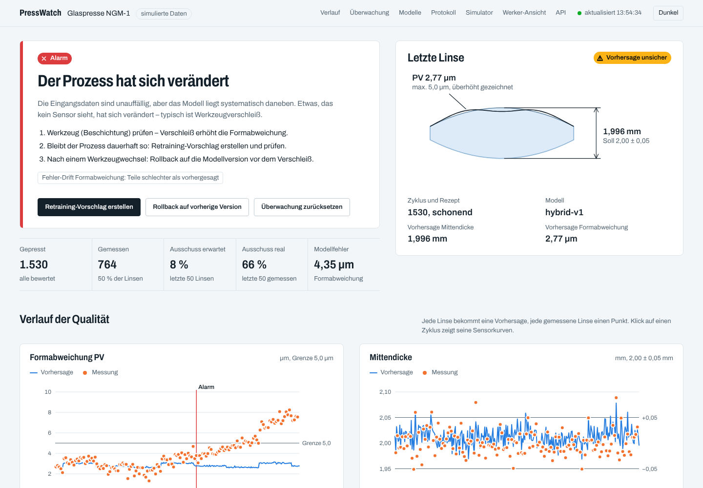
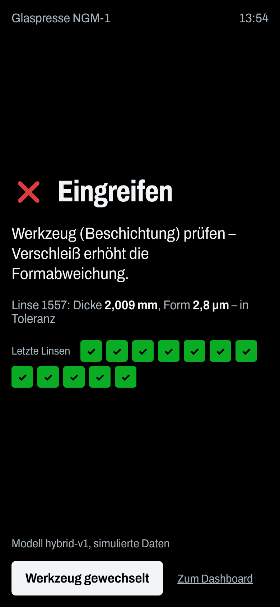
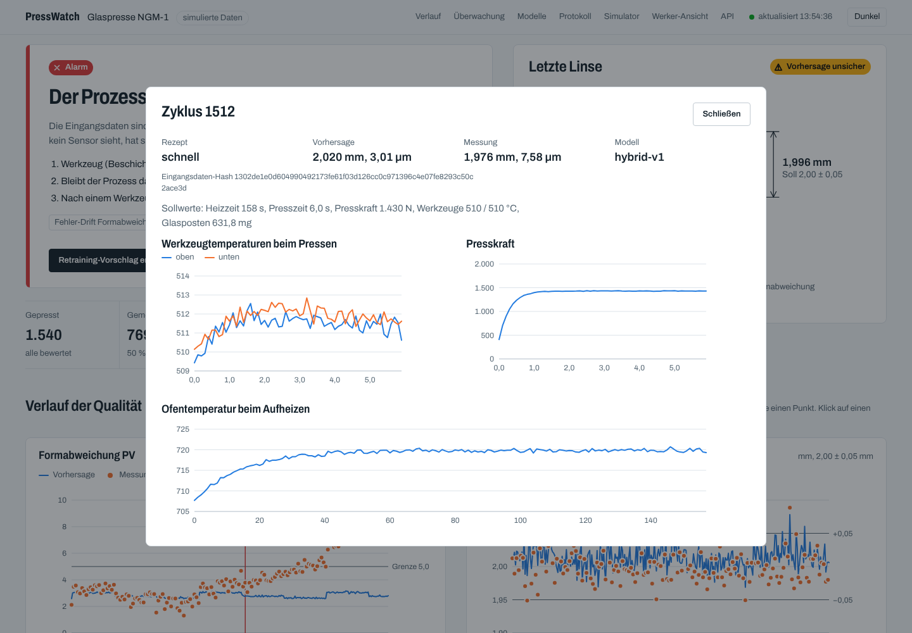
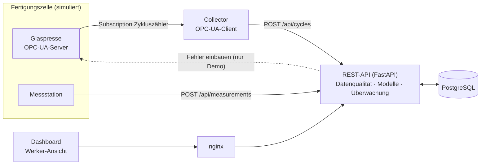
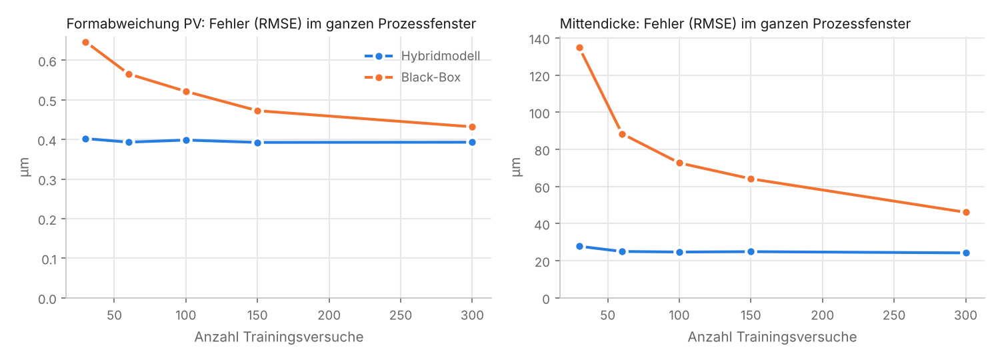
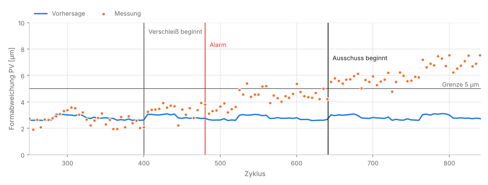

# PressWatch

**Qualitätsvorhersage und Drift-Überwachung für nicht-isothermes Glaspressen – die komplette industrielle Datenpipeline im Kleinen.**

Maschine (OPC UA) → Collector → REST-API → PostgreSQL → Modelle → Überwachung → Dashboard und Werker-Ansicht.

> Alle Daten stammen aus einem Simulator mit einem vereinfachten Prozessmodell. PressWatch zeigt Architektur und Methoden, nicht das Verhalten einer echten Presse. Es ist ein unabhängiges Lernprojekt und nicht mit dem Fraunhofer IPT verbunden.



## Warum

Ein ML-Modell, das im Notebook gute Zahlen liefert, ist noch keine Lösung für die Produktion. Es muss an die Maschine angebunden sein, mit schlechten Daten umgehen, rückverfolgbar sein, und jemand muss merken, wenn es nicht mehr stimmt. Dann stellt sich die Frage: neu trainieren, oder die Maschine reparieren?

PressWatch beantwortet diese Fragen durchgängig für einen Use Case: die Vorhersage von **Mittendicke** und **Formabweichung (PV)** gepresster Glaslinsen aus Maschinendaten.

## Was PressWatch kann

- **Maschinenanbindung über OPC UA:** Subscription auf den Zykluszähler, Konsistenzprüfung, Erkennung verpasster Zyklen, Puffer bei API-Ausfall, automatisches Wiederverbinden.
- **Datenqualität:** Prüfungen auf fehlende Werte, unmögliche Messwerte, eingefrorene Sensoren, Soll-Ist-Abweichung, falsche Kurvenlängen. Fehlerhafte Zyklen gehen in Quarantäne statt ins Modell.
- **Zwei Modelle im Vergleich:** Black-Box (Gradient Boosting) gegen ein **Hybridmodell** (physikalische Expertenmerkmale + Lasso). Das Hybridmodell ist bei wenig Daten deutlich genauer.
- **Rückverfolgbarkeit:** Jede Vorhersage speichert Modellversion und SHA-256-Hash ihrer Eingangsdaten. Jedes Modell hat eine Modellkarte mit Trainingsdaten-Hash, Gültigkeitsbereich und Grenzen.
- **Überwachung mit Ursachenvermutung:** Daten-Drift (PSI + KS-Test) und Fehler-Drift (CUSUM). Aus der Kombination folgt die Empfehlung: *Prozess verändert* → Werkzeug prüfen; *Sensorproblem* → Sensor prüfen, **nicht** neu trainieren.
- **Mensch entscheidet:** Retraining ist nur ein Vorschlag, mit Vergleich auf den neuesten Linsen. Freigabe, Ablehnung, Rollback und Reset brauchen Name und Begründung und landen im Protokoll.
- **Dashboard und Werker-Ansicht:** Das Dashboard ist für Ingenieure. Die Werker-Ansicht zeigt eine einzige Handlungsanweisung, schwarzer Hintergrund für durchsichtige Smart Glasses.
- **Ein Befehl oder Docker Compose:** SQLite-Demo mit einem Befehl, oder getrennte Dienste mit PostgreSQL und nginx.

## Schnellstart

### Variante A: ein Befehl, ohne Docker

Python 3.10 oder neuer. In PowerShell (Windows):

```powershell
python -m venv .venv
.venv\Scripts\Activate.ps1
pip install -e ".[dev]"
presswatch demo --fresh
```

macOS/Linux: `source .venv/bin/activate` statt der zweiten Zeile.

Dann im Browser öffnen:

| Was | Adresse |
|---|---|
| Dashboard | http://127.0.0.1:8000 |
| Werker-Ansicht (Handy, Smart Glasses) | http://127.0.0.1:8000/werker |
| API-Doku (OpenAPI) | http://127.0.0.1:8000/docs |
| OPC-UA-Server der Presse | `opc.tcp://127.0.0.1:4840/presswatch/` |

Beim ersten Start fährt PressWatch 150 Einfahrversuche, trainiert beide Modelle und aktiviert das bessere. Das dauert wenige Sekunden.

### Variante B: Docker Compose

```bash
docker compose up --build
```

Jetzt laufen fünf getrennte Dienste: `db` (PostgreSQL 16), `api`, `cell` (simulierte Presse + Messstation), `collector` und `nginx`. Das Dashboard liegt auf http://localhost:8080, der OPC-UA-Server auf `opc.tcp://localhost:4840/presswatch/`. Mit einem OPC-UA-Client wie UaExpert kann man direkt in die Maschine schauen.

### Variante C: Online-Demo auf Netlify (Aufzeichnung)

Netlify liefert nur statische Dateien aus, die Python-Dienste laufen dort nicht. Deshalb spielt `presswatch record` eine ganze Geschichte gegen die echte API durch: Einlaufen, Verschleiß, Alarm, Retraining, Freigabe, Werkzeugwechsel, Rollback, Sensorfehler, Reparatur. Dabei zeichnet es auf, was das Dashboard in jedem Moment sieht. Heraus kommt ein Ordner, in dem dasselbe Dashboard die Aufzeichnung abspielt, mit Abspielbalken, Kapiteln und einer Erklärung zu jedem Schritt.

```bash
presswatch record --out site
```

1. Optional: In `site/site-config.js` den Link zu deinem GitHub-Repository eintragen.
2. https://app.netlify.com/drop öffnen und den Ordner `site` hineinziehen.
3. Netlify zeigt eine Adresse wie `https://….netlify.app`. Mit einem (kostenlosen) Konto lässt sich der Name ändern.

Vorher lokal ansehen: `python -m http.server 8090 --directory site` und http://127.0.0.1:8090 öffnen. Wer das Repository mit Netlify verbindet, braucht keinen Ordner: `netlify.toml` baut die Seite bei jedem Push selbst. In der Aufzeichnung sind die Entscheidungen schon getroffen, die Buttons sind deshalb gesperrt. Klicken kann man lokal mit Variante A oder B.

## In 5 Minuten ausprobieren

Im Dashboard unter **Simulator** (diesen Teil gibt es in einer echten Fabrik nicht):

1. **Warten, bis die Überwachung eingelaufen ist.** Oben zeigt ein Balken den Fortschritt. Die Referenz braucht 150 Zyklen und 60 gemessene Linsen, im Demo-Modus etwa eine Minute.
2. **„Werkzeugverschleiß starten“.** Die Linsen werden schlechter, die Sensoren merken nichts. Nach kurzer Zeit kommt: *Alarm – Der Prozess hat sich verändert*. Das passiert, bevor die Toleranzgrenze erreicht ist.
3. **„Retraining-Vorschlag erstellen“.** Unter *Modelle* steht der Kandidat neben dem aktiven Modell, verglichen auf den neuesten Linsen. Freigeben oder ablehnen. PressWatch weist darauf hin, wenn auch der Kandidat weit danebenliegt.
4. **„Werkzeug wechseln“.** Hast du den Vorschlag vorher freigegeben, sind die Linsen jetzt *besser* als vorhergesagt: PressWatch empfiehlt einen Rollback auf das Modell vor dem Verschleiß. Ohne Freigabe stimmt das alte Modell wieder, dann setzt du nur die Überwachung zurück.
5. **„Thermoelement driften lassen“.** Der Sensor am Oberwerkzeug zeigt zu viel an, die Linsen bleiben gut. Diagnose: *Sensorproblem wahrscheinlich – nicht neu trainieren*.

Ein Klick auf einen Punkt im Verlauf öffnet die Sensorkurven dieses Zyklus. Unter *Protokoll* steht, wer wann was entschieden hat.

| Werker-Ansicht | Zyklusdetails |
|---|---|
|  |  |

## Architektur



**Ein Zyklus auf seinem Weg:** Die Presse schreibt Sollwerte, Glasposten-Masse und Sensorkurven (Ofen, Werkzeugtemperaturen, Kraft) in ihren OPC-UA-Adressraum und zählt den Zyklus hoch. Der Collector bekommt die Änderung per Subscription, liest den Zyklus, prüft, dass die Daten zum Zähler gehören, und schickt sie an die API. Die API prüft die Datenqualität, berechnet die Merkmale (dieselbe Funktion wie im Training), sagt Mittendicke und Formabweichung vorher und speichert alles. Ein paar Zyklen später meldet die Messstation das Messergebnis jeder zweiten (Demo) bzw. fünften Linse. Daraus berechnet die Überwachung den Modellfehler.

| Baustein | Datei | Was es zeigt |
|---|---|---|
| Prozessmodell | `sim/process.py` | Aufheizen, VFT-Viskosität, Stefan-Quetschströmung, Formabweichung |
| Produktion, Fehler | `sim/scenario.py`, `sim/doe.py` | Rezepte, Verschleiß, Sensordrift, Latin Hypercube |
| OPC UA | `opcua/cell.py`, `opcua/collector.py` | Server, Subscription, Puffer, Reconnect |
| Merkmale, Datenqualität | `features.py`, `quality.py` | Merkmale wie in Mende et al. (2026), Prüfungen |
| Modelle | `models/` | Black-Box, Hybrid, Modellkarte, Gültigkeitsbereich |
| Überwachung | `monitoring/` | PSI/KS, CUSUM, Entscheidungslogik |
| API, Datenbank | `api/`, `db/` | Service-Schicht, Audit-Log, Modell-Lebenszyklus |
| Oberfläche | `web/static/` | Dashboard, Werker-Ansicht, SVG-Diagramme ohne Bibliothek |

## Ergebnisse

Alle Zahlen sind mit `presswatch experiment` reproduzierbar. Details stehen in [docs/ergebnisse.md](docs/ergebnisse.md).

**Hybridmodell gegen Black-Box** (Fehler im ganzen Prozessfenster):



Mit 30 Einfahrversuchen ist das Hybridmodell bei der Mittendicke etwa 5-mal genauer als die Black-Box, bei der Formabweichung etwa 1,6-mal. Die Black-Box holt mit mehr Daten auf, erreicht das Hybridmodell aber auch mit 300 Versuchen nicht.

**Überwachung** (je 5 Läufe mit 1500 Zyklen):

| Szenario | Ergebnis |
|---|---|
| Normalbetrieb | kein Alarm, 1 Warnung in 7500 Zyklen |
| Werkzeugverschleiß | immer als „Prozess verändert“ erkannt, 56–174 Zyklen bevor Ausschuss beginnt |
| Thermoelement driftet | immer als „Sensorproblem“ erkannt, Retraining wird nicht angeboten |



**Robustheit** (getrennte Prozesse mit PostgreSQL und nginx):

- API 15 s gestoppt: Der Collector puffert 60 Zyklen und liefert sie nach, 0 Zyklen verloren.
- Presse neu gestartet: Sie zählt beim letzten Zyklus weiter, der Collector verbindet sich selbst neu, 0 Lücken.

## Was ich dabei gelernt habe

1. **Ist minus Soll überwachen, nicht Rohwerte.** Sonst sieht jeder Rezeptwechsel wie Drift aus.
2. **Modellfehler je Rezept normieren.** Das Modell liegt je Rezept unterschiedlich daneben (bis 1,5 Standardabweichungen). Ohne Normierung löst jeder Rezeptwechsel einen Fehlalarm aus.
3. **Die Kombination der Signale verrät die Ursache.** Fehler-Drift ohne Daten-Drift heißt: Etwas, das kein Sensor sieht, hat sich geändert (Verschleiß). Beides zusammen heißt: Ein Sensor lügt. Dann darf man nicht neu trainieren.
4. **Die Referenzphase braucht genug Daten.** Mit 30 statt 60 Messungen gab es in 9 von 12 normalen Läufen einen Fehlalarm, weil die Streuung zu klein geschätzt wurde.
5. **Statistik an die Stichprobe anpassen.** Mit 100 Werten und 10 Klassen liegt der PSI schon ohne jede Änderung bei etwa 0,15. PressWatch wählt die Klassenzahl deshalb nach der Stichprobengröße.
6. **Das Modell zeigt, welcher Sensor fehlt.** Ein Teil der Dickenstreuung kommt vom Wärmeverlust beim Transfer in die Presse, den niemand misst. Ohne diesen Anteil halbiert sich der Fehler. Ein Pyrometer wäre also die sinnvollste Investition.
7. **Retraining ersetzt keine Reparatur.** Bei fortschreitendem Verschleiß liegt auch ein neu trainiertes Modell bald wieder daneben.

## Bezug zu Arbeiten des Fraunhofer IPT

PressWatch greift Themen auf, die das Fraunhofer IPT veröffentlicht hat:

- **Intelligent Quality Platform (IQP):** eine Plattform, um ML-Anwendungen in der Produktion zu betreiben, zu überwachen und zu verbessern, mit einem Use Case zur Dickenvorhersage beim Präzisionsglaspressen. [Seite des Fraunhofer IPT](https://www.ipt.fraunhofer.de/en/offer/digitalization/ai-in-production/intelligent-quality-platform.html)
- **Mende et al. (2026), *Automated Hybrid Machine Learning System for Production*:** Prozessgrößen und Sensormerkmale des nicht-isothermen Glaspressens; Expertenmerkmale + Lasso schnitten am besten ab. PressWatch nutzt dieselben Eingänge und dieselbe Modellstruktur. [Publica](https://publica.fraunhofer.de/handle/publica/508800)
- **Heymann et al. (2022), *Guideline for Deployment of ML Models for Predictive Quality in Production*:** Deployment-Design, Productionizing & Testing, Monitoring und Retraining. Diese Bausteine bilden das Gerüst von PressWatch. [Publica](https://publica.fraunhofer.de/handle/publica/425840)
- **Heymann, Grunert, Schmitt (2023), *Machine Learning for Predictive Quality in Optics Production*.** [Publica](https://publica.fraunhofer.de/handle/publica/450197)
- **Mateo-Casali et al. (2026), Referenzarchitektur für KI-Systeme in der Produktion nach ISO/IEC 42001:** Nachvollziehbarkeit und Lebenszyklus-Steuerung. Daraus stammen Audit-Log, Modellkarten und die menschliche Freigabe. [DOI](https://doi.org/10.1080/0951192x.2026.2664187)
- **Lossie et al. (2025), kontextsensitive Anleitungen aus digitalem Zwilling und Smart Services:** Idee hinter der Werker-Ansicht. [Publica](https://publica.fraunhofer.de/handle/publica/499836)
- **Leyendecker et al. (2026), *A Collaborative Bayesian Optimization Dashboard for Manufacturing Process Optimization*:** möglicher nächster Schritt (siehe unten). [Publica](https://publica.fraunhofer.de/handle/publica/513162)

PressWatch erhebt keinen Anspruch, diese Arbeiten nachzubilden. Alle Konstanten sind ausgedacht, und die Norm ISO/IEC 42001 wird nicht erfüllt, nur ihre Idee der Nachvollziehbarkeit aufgegriffen.

## API

Die vollständige, ausprobierbare Doku liegt unter `/docs`. Die wichtigsten Endpunkte:

| Methode | Pfad | Zweck |
|---|---|---|
| POST | `/api/cycles` | Zyklus vom Collector (idempotent) |
| POST | `/api/measurements` | Messergebnis der Messstation |
| GET | `/api/status` | Empfehlung, Kennzahlen, Daten- und Fehler-Drift |
| GET | `/api/cycles`, `/api/cycles/{id}` | Verlauf und Details mit Kurven |
| GET | `/api/models` | Versionen mit Kennzahlen und Modellkarte |
| POST | `/api/models/proposals` | Retraining-Vorschlag erstellen |
| POST | `/api/models/{version}/activate` | Version freigeben |
| POST | `/api/models/{version}/reject` | Vorschlag ablehnen |
| POST | `/api/models/rollback` | vorherige Version reaktivieren |
| POST | `/api/monitoring/reset` | neue Referenz nach einer Reparatur |
| GET | `/api/audit` | Protokoll |
| GET/POST | `/api/sim` | Simulator-Zustand lesen, Fehler einbauen (nur Demo) |

Beispiele (funktionieren auch mit `curl.exe` unter Windows):

```bash
curl http://127.0.0.1:8000/api/status

curl -X POST http://127.0.0.1:8000/api/models/proposals \
  -H "Content-Type: application/json" \
  -d '{"actor": "Arif", "reason": "Verschleißalarm, Vorschlag prüfen"}'

curl -X POST http://127.0.0.1:8000/api/sim \
  -H "Content-Type: application/json" \
  -d '{"action": "tool_wear", "value": 0.03}'
```

## Tests

```bash
pytest                       # alle Tests, SQLite und echte OPC-UA-/HTTP-Server
pytest -m "not integration"  # ohne die Server-Tests
```

Gegen PostgreSQL (wie in der CI):

```bash
PRESSWATCH_TEST_DATABASE_URL=postgresql+psycopg://user:pw@localhost:5432/presswatch_test pytest -m postgres
```

Die Tests decken ab: Physik des Simulators, Merkmale und Datenqualität, beide Modelle (inklusive „Hybrid schlägt Black-Box bei wenig Daten“), Drift-Erkennung ohne Fehlalarme, die Entscheidungslogik, alle API-Abläufe mit Audit, PostgreSQL, die komplette Kette OPC UA → Collector → API sowie drei vollständige Produktionsläufe. Die GitHub-Actions-CI prüft Lint, Formatierung, Tests auf Python 3.11 bis 3.13 mit PostgreSQL und den Docker-Build.

## Projektstruktur

```
presswatch/
├── src/presswatch/
│   ├── sim/            Prozessmodell, Rezepte, Fehler, Versuchsplanung
│   ├── opcua/          Presse als OPC-UA-Server, Collector, Demo-Steuerung
│   ├── models/         Black-Box, Hybridmodell, Modellkarte
│   ├── monitoring/     Daten-Drift, Fehler-Drift, Entscheidungslogik
│   ├── db/             Datenbankschema
│   ├── api/            FastAPI-App, Service-Schicht, Schemas
│   ├── web/static/     Dashboard, Werker-Ansicht
│   ├── experiments/    Experimente hinter den Zahlen in diesem README
│   ├── features.py     Merkmale (Training und Betrieb identisch)
│   ├── quality.py      Datenqualität
│   ├── static_site.py  Aufzeichnung und statische Seite für Netlify
│   └── cli.py          presswatch demo | api | cell | collector | experiment | record
├── tests/              Unit-, API-, PostgreSQL- und Integrationstests
├── deploy/nginx.conf
├── docker-compose.yml, Dockerfile, netlify.toml
└── docs/               Ergebnisse, Bilder, Lernpfad
```

## Grenzen und nächste Schritte

**Bewusst vereinfacht:** Die Daten sind simuliert. Die Online-Demo ist eine Aufzeichnung, keine laufende Anlage. OPC UA läuft ohne Verschlüsselung (in echt: Basic256Sha256 mit Zertifikaten). Die API hat keine Benutzerverwaltung, der Name in Entscheidungen ist frei eingegeben. Datenbankmigrationen (Alembic) fehlen. Modelle liegen als joblib-Datei in der Datenbank und dürfen nur aus eigener Quelle geladen werden. Es gibt nur eine Maschine.

**Nächste Schritte:**
- Bayes'sche Optimierung der Rezepte mit erklärendem Dashboard, aufbauend auf Leyendecker et al. (2026).
- OPC-UA-Sicherheit mit Zertifikaten, Login und Rollen in der API.
- Verwaltungsschale (Asset Administration Shell) für die Presse.
- Werker-Ansicht auf echter Smart-Glasses-Hardware mit Sprachbefehlen.

## English summary

PressWatch is a small end-to-end industrial ML pipeline for non-isothermal glass molding: a simulated press publishes cycles via OPC UA, a collector forwards them to a FastAPI service backed by PostgreSQL, which checks data quality, predicts center thickness and form deviation with a hybrid model (physics-based expert features + Lasso; clearly better than a gradient-boosting black box with little data), and monitors data drift (PSI + KS on actual-minus-setpoint features) and model-error drift (per-recipe CUSUM). The combination of signals yields a likely cause: process change (tool wear, offer retraining) or faulty sensor (fix the sensor, do not retrain). Retraining is only ever a proposal; activation, rejection and rollback need a person and a reason and are written to an audit log. A dashboard and an operator view for smart glasses complete it. Run it with `presswatch demo` or `docker compose up`.

## Lizenz

MIT, siehe [LICENSE](LICENSE). Die Schrift Archivo steht unter der SIL Open Font License 1.1.
