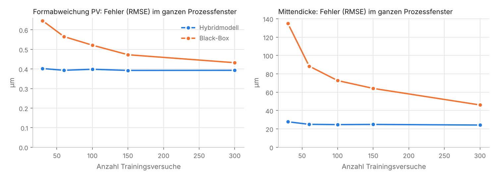
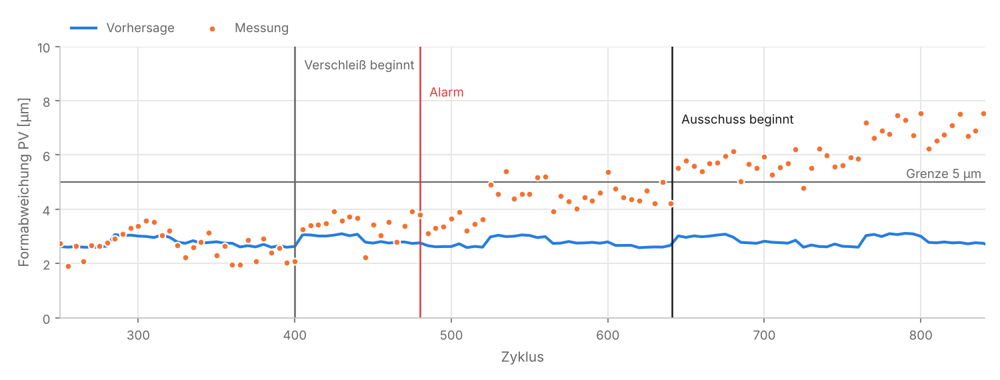

# Ergebnisse der Experimente

Erzeugt mit `presswatch experiment` am 25.11.2026 13:50. Alle Daten stammen aus dem Simulator.

## 1. Hybridmodell gegen Black-Box

Trainiert auf Einfahrversuchen (Latin Hypercube), getestet auf 300 neuen Versuchen im ganzen Prozessfenster und auf 600 Linsen aus dem laufenden Betrieb. Fehler als RMSE, Mittelwert aus 3 Wiederholungen.

| Versuche | Modell | PV Fenster [µm] | PV Betrieb [µm] | Dicke Fenster [µm] | Dicke Betrieb [µm] |
|---:|---|---:|---:|---:|---:|
| 30 | Hybrid | 0,40 | 0,38 | 27,8 | 17,5 |
| 30 | Black-Box | 0,65 | 0,59 | 135,1 | 82,2 |
| 60 | Hybrid | 0,39 | 0,35 | 25,0 | 17,5 |
| 60 | Black-Box | 0,57 | 0,52 | 88,4 | 50,5 |
| 100 | Hybrid | 0,40 | 0,37 | 24,7 | 15,1 |
| 100 | Black-Box | 0,52 | 0,49 | 72,7 | 67,6 |
| 150 | Hybrid | 0,39 | 0,36 | 24,9 | 17,0 |
| 150 | Black-Box | 0,47 | 0,45 | 64,1 | 38,0 |
| 300 | Hybrid | 0,39 | 0,34 | 24,2 | 15,6 |
| 300 | Black-Box | 0,43 | 0,40 | 46,1 | 38,9 |

## 2. Überwachung in drei Produktionsläufen

Je Lauf 1500 Zyklen, jede 5. Linse wird gemessen, Fehler ab Zyklus 400. Werkzeugverschleiß: +0,01 µm Formabweichung je Zyklus. Sensorfehler: Thermoelement oben driftet mit 0,1 °C je Zyklus bis +20 °C. „Ausschuss beginnt“ heißt: mindestens 20 % der letzten 50 Linsen außerhalb der Toleranz.

| Szenario | Seed | erste Warnung | Ursache | Alarm | Ursache | Ausschuss ab | Vorwarnzeit |
|---|---:|---:|---|---:|---|---:|---:|
| normal | 7 | – | – | – | – | – | – |
| normal | 8 | – | – | – | – | – | – |
| normal | 9 | – | – | – | – | – | – |
| normal | 10 | – | – | – | – | – | – |
| normal | 11 | 720 | eingangsdaten | – | – | – | – |
| werkzeugverschleiss | 7 | 480 | prozess | 480 | prozess | 641 | 161 Zyklen |
| werkzeugverschleiss | 8 | 500 | prozess | 500 | prozess | 556 | 56 Zyklen |
| werkzeugverschleiss | 9 | 500 | prozess | 500 | prozess | 558 | 58 Zyklen |
| werkzeugverschleiss | 10 | 460 | prozess | 460 | prozess | 634 | 174 Zyklen |
| werkzeugverschleiss | 11 | 460 | prozess | 460 | prozess | 560 | 100 Zyklen |
| sensorfehler | 7 | 440 | eingangsdaten | 550 | sensor | – | – |
| sensorfehler | 8 | 440 | eingangsdaten | 530 | sensor | – | – |
| sensorfehler | 9 | 440 | eingangsdaten | 530 | sensor | – | – |
| sensorfehler | 10 | 440 | eingangsdaten | 520 | sensor | – | – |
| sensorfehler | 11 | 450 | eingangsdaten | 540 | sensor | – | – |

